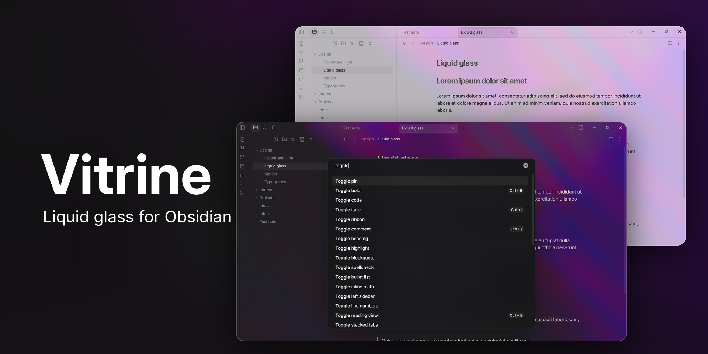
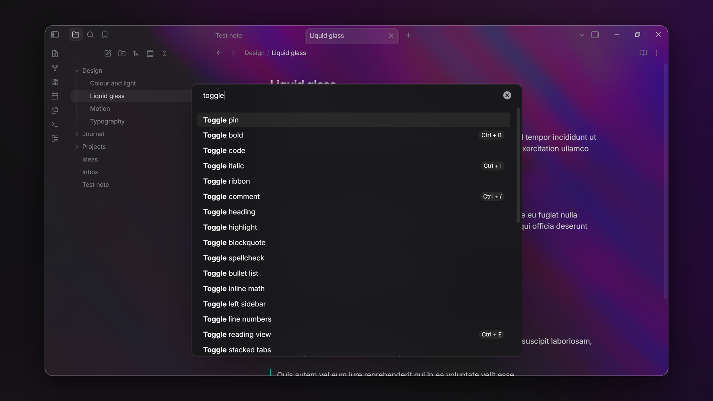
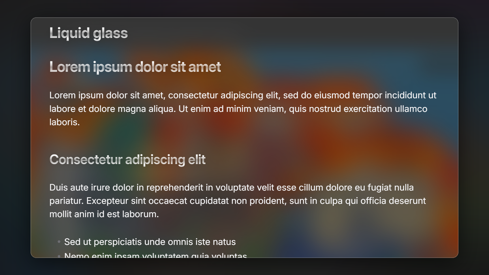
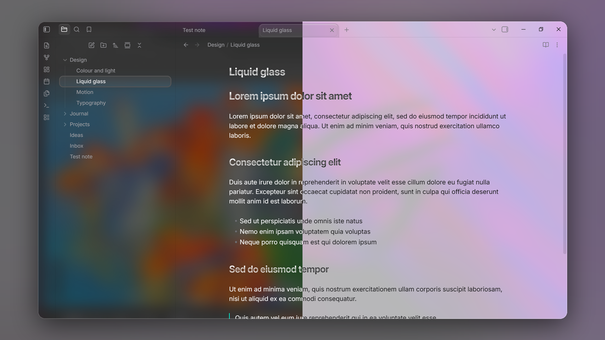

<div align="center">



### Frosted, translucent and refracting glass for Obsidian.

</div>

## Overview

**Glass panels.** The command palette, modals, menus, popovers, notices and the status bar are frosted, with a thin outline and a bright top edge.



**Glass headings.** H1, H2 and the note title get glass lettering by default, in editing view and reading view.



**Dark and light mode.** Each has its own colours and edge lighting.



**Built on Obsidian's own variables.** Where Obsidian documents a variable for a surface, the theme sets that variable instead of overriding the element, so it keeps working across updates.

> [!NOTE]
> Desktop only. The see-through window in these screenshots comes from the [Vitrine plugin](https://github.com/Invictus2076/vitrine-plugin) on Windows. The theme works on its own too, with a solid tinted window.

## Installation

1. Open **Settings → Appearance**.
2. Next to **Themes**, choose **Manage**, search for **Vitrine**, and choose **Install and use**.
3. Choose dark or light mode; both are supported.

To install by hand, download `theme.css` and `manifest.json` from the [latest release](https://github.com/Invictus2076/vitrine-theme/releases/latest) into `.obsidian/themes/Vitrine/` in your vault, then select the theme in **Settings → Appearance**.

## Companion plugin

### [Vitrine plugin](https://github.com/Invictus2076/vitrine-plugin)

Five presets and a Custom look, a translucent window that shows your wallpaper on Windows, refraction at panel edges, and settings for all of it.

## Customization

The theme reads these CSS variables from `<body>`. Set them in a [CSS snippet](https://help.obsidian.md/snippets) to change the look; the values below are the defaults.

```css
body {
  --vt-blur: 24px;          /* blur behind floating panels */
  --vt-saturation: 180%;    /* colour that comes through panels */
  --vt-radius: 18px;        /* corner radius of large panels */
}
.theme-dark {
  --vt-dark-window-tint: 18%;   /* base colour over the window background */
  --vt-dark-panel-tint: 74%;    /* how solid floating panels are */
  --vt-dark-highlight: 22%;     /* light line along the top of panels */
  --vt-dark-ring: 10%;          /* thin outline around panels */
}
.theme-light {
  --vt-light-window-tint: 70%;
  --vt-light-panel-tint: 74%;
  --vt-light-highlight: 85%;
  --vt-light-ring: 10%;
}
```

When the plugin is enabled it sets these for you from the preset you choose, and any snippet values are replaced.

## Limits

- If the window itself is made translucent on Windows, the browser stops drawing blur behind panels. The Vitrine plugin works around this; the theme alone can't.
- Only Obsidian 1.15.0 has been tested.

## License

Vitrine is licensed under the [MIT license](./LICENSE).
